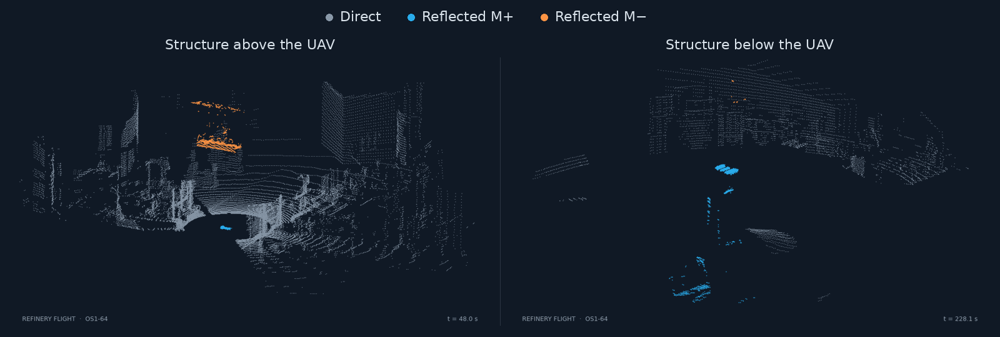
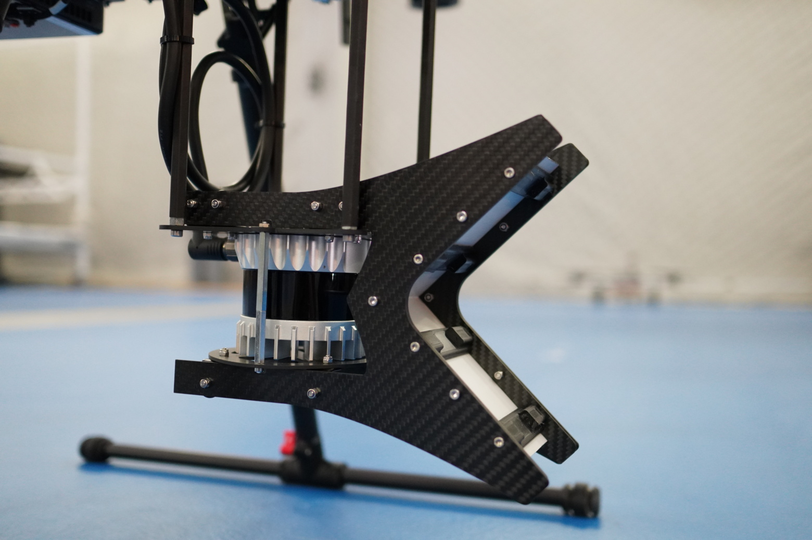
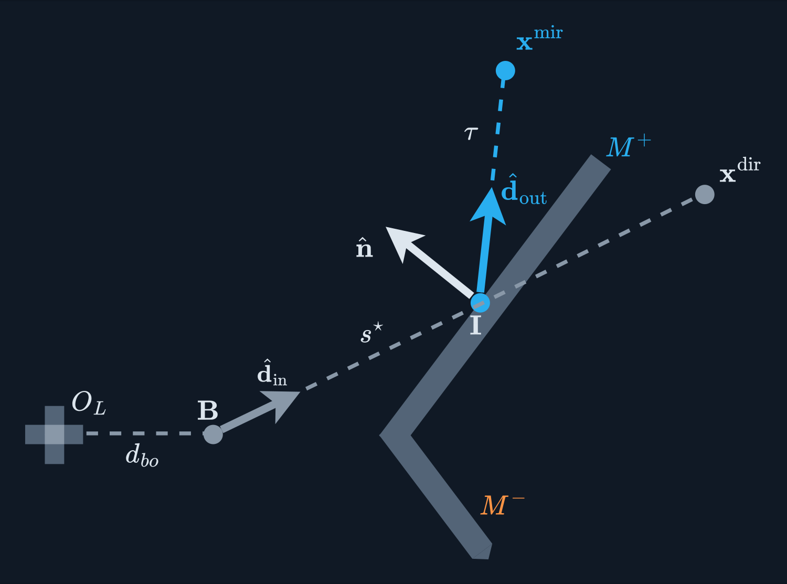

# Mirror-Based LiDAR Reconstruction for Ouster ROS 2

This repository extends the official [Ouster ROS driver](https://github.com/ouster-lidar/ouster-ros/tree/ros2) with reconstruction through configurable planar mirrors. Fixed mirrors redirect selected beams toward regions outside the native field of view (FoV). Their optical paths are incorporated into the driver's direction-and-offset lookup table (LUT), so direct and reflected measurements use the same affine coordinate calculation, without per-point ray tracing or an external correction node.



For standard sensor setup, supported devices, network configuration and other ROS 2 functionality, refer to the [upstream documentation](https://github.com/ouster-lidar/ouster-ros/tree/ros2).

## Sensor and mirror assembly

<p align="center">
  
</p>

*Ouster OS1-64 with the dual-mirror assembly mounted upside down beneath the UAV.*

## Mirror-based reconstruction

At initialization, the processor intersects each native beam with the configured finite mirror polygons. A valid intersection replaces that beam's LUT coefficients with their reflected equivalents. Beams that miss every mirror retain their native coefficients. If several mirrors intersect the same incident ray, the nearest positive intersection is selected.

<p align="center">
  
</p>

For a native LUT entry `x = r d + o` and a mirror plane through `p` with unit normal `n`, the reflected coefficients are:

```text
d_mirror = d - 2 n (n · d)
o_mirror = o - 2 n (n · (o - p))
x_mirror = r d_mirror + o_mirror
```

Here `r` is the original integer range, `d` includes its conversion to meters, and `o` and `p` are expressed in meters. The finite-footprint test uses the physical beam origin and the SDK's range-origin correction. A precomputed minimum range rejects measurements whose optical path ends before reaching the mirror.

The LUT is computed once from the sensor metadata and fixed mirror geometry. XYZ evaluation retains three multiplications and three additions per point; validity checks and packing `mirror_id` add processing and memory copying. The Ouster SDK is unchanged.

## Installation

The extension has been built and tested with **ROS 2 Humble**. Build this mirror-enabled checkout from source.

### Download the repository

```bash
mkdir -p ~/ws/src
cd ~/ws/src
git clone --branch main --recurse-submodules https://github.com/catec/ouster-ros-mirrors.git ouster-ros
cd ~/ws
```

If you already have this repository checked out in a ROS workspace, use that workspace and initialize its submodules:

```bash
git -C src/ouster-ros submodule update --init --recursive
```

### Install dependencies and build

With ROS 2 Humble and `rosdep` installed and initialized, run the following from the workspace root:

```bash
source /opt/ros/humble/setup.bash
rosdep update
rosdep install --from-paths src --ignore-src --rosdistro humble -y
colcon build --symlink-install --cmake-args -DCMAKE_BUILD_TYPE=Release -DBUILD_TESTING=ON
source install/setup.bash
```

Use the upstream [requirements](https://github.com/ouster-lidar/ouster-ros/tree/ros2#requirements) for general system prerequisites. RViz is optional when launching with `viz:=false`.

## Configuration and execution

The extension is available in both `os_driver` for a live sensor and `os_cloud` for separate processing of raw packets. Configure these two startup parameters:

| Parameter | Type | Description |
|---|---|---|
| `mirror_names` | String array | Unique names in `mirror_id` order. An empty array disables reconstruction. |
| `mirror_corners` | Double array | Four consecutive XYZ vertices per mirror: 12 values for each entry in `mirror_names`. |

Vertices must follow the perimeter of a planar, convex, nondegenerate quadrilateral; either winding is accepted. Coordinates are **meters in the sensor's LIDAR frame** (`lidar_frame`, normally `os_lidar`), including when the output cloud is transformed into another frame. There is no hard-coded channel count, scan width, world orientation or two-mirror restriction.

The [dual-mirror example](ouster-ros/config/mirror_example.yaml) is a standalone configuration containing all parameters from `driver_params.yaml`, with our mirror geometry enabled and `SCAN`/`IMG` disabled. Both mirrors' corner coordinates are already supplied, and the output uses the LiDAR frame:

```yaml
/**:
  ros__parameters:
    sensor_hostname: <SENSOR_HOSTNAME>
    point_cloud_frame: os_lidar
    point_type: original
    proc_mask: IMU|PCL|RAW|TLM
    mirror_names: [m_plus, m_minus]
    # mirror_corners: 12 values per mirror; see the complete example file.
```

The complete example file contains the remaining driver parameters and corner coordinates. For our setup, change only `sensor_hostname` before launching. For a different assembly, replace the corners with its measured geometry in the LIDAR frame. Names are labels; they do not impose a reflection direction. Geometry is read-only after startup, so restart the node after changing it.

The standard [driver_params.yaml](ouster-ros/config/driver_params.yaml) leaves mirrors disabled. Copying the two mirror parameters into your own driver YAML also enables the extension. To disable it, leave `mirror_names` and `mirror_corners` empty.

### Live sensor

From the built workspace, copy our complete configuration:

```bash
cp src/ouster-ros/ouster-ros/config/mirror_example.yaml mirror_params.yaml
```

Set `sensor_hostname` in `mirror_params.yaml` to your sensor's hostname or IP address, then launch with the supplied dual-mirror geometry:

```bash
source /opt/ros/humble/setup.bash
source install/setup.bash
ros2 launch ouster_ros driver.launch.py params_file:="$PWD/mirror_params.yaml" viz:=false
```

## Point-cloud output

With mirrors configured, each point in `/ouster/points` includes an additional **`UINT16` field named `mirror_id`**. The same field is included in `/ouster/points2` for dual-return operation.

| `mirror_id` | Meaning |
|---|---|
| `0` | Native direct beam. |
| `1..N` | Beam assigned to `mirror_names[mirror_id - 1]`. |

The ID stays attached to its point through destaggering, vertical reduction and organized or unorganized output. No separate index topic is needed. It describes the beam path, not return validity: an invalid organized point can have a nonzero ID and NaN coordinates. Unorganized output omits invalid points as usual.

Only XYZ is reconstructed. Other fields supplied by the selected `point_type` retain their values, including timestamps, native ring, original range, signal/intensity and reflectivity.

With no mirrors configured, the native LUT and cloud schema are unchanged. Downstream code that converts messages to a fixed PCL point type may discard `mirror_id`. Preserve the field explicitly when it is needed.

## Limitations and testing

The model assumes fixed planar mirrors, a single specular reflection and a reciprocal return path. It does not model multiple bounces, partial beam interception, propagation through a glass substrate, multipath or occlusion by the mounting structure.

Only **PointCloud2** geometry is remapped. Native rings and adjacent range-image cells do not necessarily represent adjacent outgoing directions across a mirror boundary. Downstream algorithms should use the reconstructed coordinates accordingly.

Run the unit and integration tests from the workspace root after building with `BUILD_TESTING=ON`:

```bash
source /opt/ros/humble/setup.bash
source install/setup.bash
colcon test --packages-select ouster_ros --event-handlers console_direct+
colcon test-result --verbose
```

## Acknowledgments and license

This extension builds on the Ouster ROS driver and Ouster SDK developed by **Ouster, Inc. and contributors**. General driver functionality remains documented and maintained in the [official repository](https://github.com/ouster-lidar/ouster-ros).

The planar-mirror extension is copyright (c) 2026 CATEC and is distributed under the **BSD-3-Clause** license. The original Ouster copyright notices and [license](LICENSE), including bundled third-party notices, are retained.

## Contact and contributions

Questions about the mirror extension? Contact David Tejero Ruiz
([dtejero@catec.aero](mailto:dtejero@catec.aero)), CATEC.

Found a bug or have a feature request? Open an issue!

Want to contribute? Submit a pull request!
